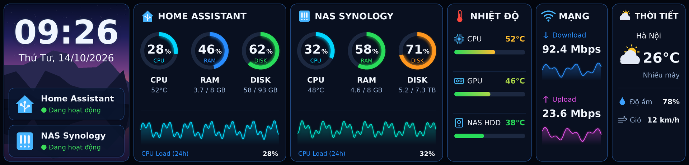
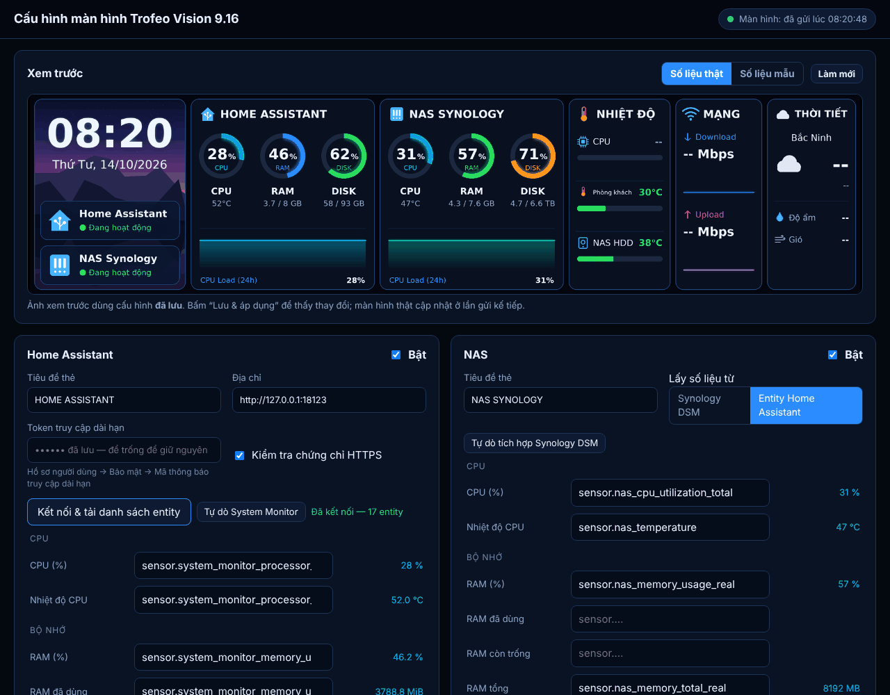

# TRCC Dashboard — Trofeo Vision 9.16 LCD

Biến màn hình **Thermalright Trofeo Vision 9.16 LCD** (1920×462) thành bảng theo dõi
nhà thông minh: đồng hồ, **Home Assistant**, **NAS Synology**, nhiệt độ, tốc độ mạng và
thời tiết. Mọi thứ cấu hình qua một **trang web**, không cần sửa file.



*Ảnh trên vẽ bằng số liệu mẫu (`trcc-dashboard --demo`).*

---

## Mục lục

1. [Tính năng](#tính-năng)
2. [Yêu cầu](#yêu-cầu)
3. [Cài đặt](#cài-đặt)
4. [Cấu hình bằng trang web](#cấu-hình-bằng-trang-web)
5. [Sử dụng hằng ngày](#sử-dụng-hằng-ngày)
6. [Lệnh `trcc-dashboard`](#lệnh-trcc-dashboard)
7. [Cấu hình bằng file](#cấu-hình-bằng-file)
8. [Cấu hình từ máy khác](#cấu-hình-từ-máy-khác)
9. [Cập nhật và gỡ cài đặt](#cập-nhật-và-gỡ-cài-đặt)
10. [Xử lý sự cố](#xử-lý-sự-cố)
11. [Bảo mật](#bảo-mật)
12. [Cách hoạt động](#cách-hoạt-động)
13. [Phát triển và kiểm thử](#phát-triển-và-kiểm-thử)

---

## Tính năng

| Ô trên màn hình | Hiển thị | Lấy số liệu từ |
|---|---|---|
| **Đồng hồ** | Giờ, thứ/ngày, trạng thái Home Assistant và NAS | Giờ của máy; ảnh nền tự vẽ hoặc ảnh của bạn |
| **Home Assistant** | 3 vòng CPU / RAM / ổ đĩa, nhiệt độ CPU, dung lượng, biểu đồ CPU 24 giờ | Entity bất kỳ, thường là tích hợp **System Monitor** |
| **NAS Synology** | Như trên, cho NAS | Web API của **DSM**, hoặc tích hợp **Synology DSM** trong Home Assistant |
| **Nhiệt độ** | 1–4 dòng có thanh màu | CPU/GPU của máy này, CPU/ổ cứng NAS, hoặc **bất kỳ cảm biến nào** trong Home Assistant |
| **Mạng** | Tốc độ tải xuống/tải lên kèm biểu đồ | Card mạng của máy này, hoặc entity Home Assistant (vd. router) |
| **Thời tiết** | Nhiệt độ, trạng thái, độ ẩm, gió | [Open-Meteo](https://open-meteo.com): miễn phí, không cần tài khoản |

Ngoài ra:

- **Trang web cấu hình**:
  - Chọn entity từ danh sách lấy trực tiếp từ Home Assistant, kèm giá trị hiện tại.
  - Tự dò entity System Monitor và Synology DSM.
  - Kiểm tra kết nối NAS.
  - Xem trước ảnh màn hình.
- **Áp dụng ngay**: bấm Lưu là màn hình đổi ở lần cập nhật kế tiếp, không cần khởi động lại.
- **Chịu lỗi**: nguồn số liệu nào hỏng thì ô đó hiện `--` hoặc **Mất kết nối**, các ô khác vẫn chạy.
- **Màu cảnh báo**: vòng tải chuyển cam khi ≥ 70%, đỏ khi ≥ 90%; thanh nhiệt độ chuyển từ xanh sang đỏ.
- **Lịch sử CPU 24 giờ** được lưu lại, khởi động lại không mất.
- **Tự chạy** khi bật máy (dịch vụ systemd).

## Yêu cầu

| | |
|---|---|
| Hệ điều hành | **Debian 12 (Bookworm) trở lên**, hoặc Ubuntu 22.04+ và các bản dựa trên Debian. Cần Python ≥ 3.10 |
| Màn hình | Thermalright Trofeo Vision 9.16 LCD (USB `0416:5408`) đã chạy được với **trcc** (`trcc detect` thấy thiết bị) — xem [HUONG_DAN_DEBIAN.md](../HUONG_DAN_DEBIAN.md) |
| Gói hệ thống | `python3-pil`, `python3-psutil`, `fonts-dejavu-core` (script cài tự cài) |
| Home Assistant | Tuỳ chọn. Cần URL + **token truy cập dài hạn** |
| NAS Synology | Tuỳ chọn. DSM 7, tài khoản thuộc nhóm administrators, **không bật 2FA**; hoặc qua Home Assistant |

## Cài đặt

### 1. Lấy mã nguồn

**Từ file nén** `trcc-dashboard-*.tar.gz`:
```bash
cd ~
tar xzf ~/Downloads/trcc-dashboard-*.tar.gz
cd trcc-dashboard
```

**Hoặc từ git:**
```bash
sudo apt install git
git clone https://github.com/KinhBacsmarthome/TROFEO-VISION-9.16-LCD-WHITE.git
cd TROFEO-VISION-9.16-LCD-WHITE/dashboard
```

### 2. Chạy script cài

```bash
./install.sh
```

Chạy bằng **tài khoản thường, không dùng `sudo`**. Script tự hỏi mật khẩu khi cần cài gói. Script sẽ:

1. Cài `python3-pil python3-psutil fonts-dejavu-core` bằng apt.
2. Kiểm tra Python ≥ 3.10.
3. Chép chương trình vào `~/.local/share/trcc-dashboard/`.
4. Tạo lệnh `~/.local/bin/trcc-dashboard`.
5. Cài và bật dịch vụ systemd `trcc-dashboard`, tự chạy khi đăng nhập.
6. Kiểm tra lệnh `trcc` đã có chưa.

Kết quả đúng sẽ kết thúc bằng:
```
 ✓ Dịch vụ đang chạy (tự chạy lại khi đăng nhập)
==> Xong! Mở trang cấu hình: http://127.0.0.1:8765
```

Tuỳ chọn của script:

| Tuỳ chọn | Ý nghĩa |
|---|---|
| `--no-apt` | Bỏ qua bước cài gói, nếu bạn đã tự cài |
| `--no-service` | Không cài dịch vụ systemd; tự chạy `trcc-dashboard --web -v` khi cần |

Muốn dashboard chạy cả khi **chưa đăng nhập** (máy chỉ bật, không ai đăng nhập):
```bash
sudo loginctl enable-linger $USER
```

### 3. Chỉnh màn hình trong trcc

Mở `trcc gui` và đặt **góc xoay màn hình là 0°** (hoặc 180° nếu lắp ngược), rồi **đóng** trcc gui.
Dashboard vẽ ảnh nằm ngang đúng 1920×462.

### 4. Cấu hình

Mở **http://127.0.0.1:8765** trên trình duyệt của máy đó và làm theo phần dưới.

## Cấu hình bằng trang web



Làm từ trên xuống, xong bấm **Lưu & áp dụng** ở góc dưới phải.

### Home Assistant

1. **Bật System Monitor trong Home Assistant** (để có CPU/RAM/ổ đĩa của máy chạy HA):
   - Vào **Cài đặt → Thiết bị & dịch vụ → Thêm tích hợp → System Monitor**.
   - Mở tích hợp, vào tab **Thực thể** và **bật** các cảm biến cần dùng, vì chúng tắt sẵn:
     *Processor use, Processor temperature, Memory usage, Memory use, Memory free,
     Disk usage /, Disk use /, Disk free /*.
2. **Tạo token:**
   - Bấm tên người dùng ở góc trái dưới → tab **Bảo mật** → **Mã thông báo truy cập dài hạn** → **Tạo mã**.
   - Sao chép ngay, vì HA chỉ hiện mã một lần.
3. **Trên trang cấu hình:**
   - Nhập **Địa chỉ** (vd. `http://192.168.1.20:8123`) và dán **Token**.
   - Bấm **Kết nối & tải danh sách entity**. Kết quả đúng: *Đã kết nối — N entity*.
   - Bấm **Tự dò System Monitor** để tự điền các ô.
4. **Kiểm tra** cột giá trị màu xanh bên phải mỗi ô: ô trống hoặc *không thấy* thì gõ vào ô để tìm entity khác. Ô nào không cần thì để trống.

Bạn có thể gán **bất kỳ entity nào**, không nhất thiết là System Monitor. Ý nghĩa các ô:

| Ô | Dùng cho | Gợi ý |
|---|---|---|
| CPU (%) | Vòng CPU, biểu đồ 24h | |
| Nhiệt độ CPU | Dòng dưới vòng CPU | |
| RAM (%) | Vòng RAM | Thiếu thì tự tính từ đã dùng / tổng |
| RAM đã dùng / còn trống / tổng | Dòng "3.7 / 8 GB" | Chỉ cần 2 trong 3. Đơn vị (MiB, GiB, GB…) đọc tự động |
| Ổ đĩa (%) | Vòng DISK | Thiếu thì tự tính |
| Ổ đĩa đã dùng / còn trống / tổng | Dòng "58 / 93 GB" | Chỉ cần 2 trong 3 |
| Nhiệt độ ổ cứng | Dùng cho dòng nhiệt độ `ha:disk` / `nas:disk` | |

### NAS

Chọn một trong hai nguồn:

- **Synology DSM** (đọc thẳng NAS):
  - Trong DSM, vào **Bảng điều khiển → Người dùng & Nhóm** và tạo tài khoản riêng (vd. `dashboard`):
    cho vào nhóm **administrators** và **không bật xác thực 2 bước**.
  - Trên trang: nhập địa chỉ (vd. `https://192.168.1.10:5001`), tài khoản, mật khẩu, rồi bấm **Kiểm tra kết nối**.
    Kết quả đúng: *OK — CPU …%, RAM …%*.
  - **Volume**: để trống để cộng tất cả các volume, hoặc ghi `volume_1`.
  - Bỏ chọn *Kiểm tra chứng chỉ HTTPS* nếu DSM dùng chứng chỉ tự ký (thường gặp).
- **Entity Home Assistant**: nếu HA đã có tích hợp **Synology DSM**, chọn nguồn này rồi bấm
  **Tự dò tích hợp Synology DSM**.

### Nhiệt độ

Mỗi dòng gồm **Nhãn** (chữ hiện trên màn hình) và **Nguồn**:

| Nguồn | Lấy từ |
|---|---|
| `local:cpu` | CPU của máy đang cắm màn hình (`coretemp` / `k10temp`) |
| `local:gpu` | GPU của máy này (AMD qua hwmon, NVIDIA qua `nvidia-smi`) |
| `nas:cpu` / `nas:disk` | Hệ thống NAS / ổ cứng nóng nhất của NAS |
| `ha:cpu` / `ha:disk` | Từ các ô của thẻ Home Assistant |
| `sensor.xxx` | Bất kỳ cảm biến nào trong HA, vd. nhiệt độ phòng, tủ rack, bể cá… |

Màn hình đẹp nhất với 3 dòng, tối đa 4. **Nhiệt độ ứng với thanh đầy** mặc định 90 °C.

### Mạng, thời tiết, màn hình

- **Mạng**:
  - *Card mạng máy này*: để trống để cộng mọi card, hoặc ghi tên card (xem bằng `ip link`).
  - *Entity Home Assistant*: dùng tốc độ WAN của router, các đơn vị kB/s, Mbit/s… đều đọc được.
- **Thời tiết**: chọn thành phố có sẵn (Hà Nội, Bắc Ninh, Hải Phòng, Đà Nẵng, TP. HCM…) hoặc tự nhập vĩ độ/kinh độ.
- **Màn hình & gửi ảnh**:
  - Mã thiết bị (`0416:5408`) và thời gian cập nhật (mặc định 5 giây).
  - Cách gửi ảnh: để **Tự chọn**.
  - Ảnh nền ô đồng hồ: để trống để tự vẽ núi và hồ.

## Sử dụng hằng ngày

Sau khi cài, **không cần làm gì**: bật máy là màn hình tự hiện dashboard.

| Muốn… | Làm |
|---|---|
| Đổi entity, NAS, thời tiết… | Mở http://127.0.0.1:8765, sửa rồi bấm **Lưu & áp dụng** |
| Xem màn hình đang hiện gì | Ô **Xem trước** trên trang cấu hình |
| Xem có đang chạy không | Chấm màu ở góc trên phải trang cấu hình, hoặc `systemctl --user status trcc-dashboard` |
| Xem log | `journalctl --user -u trcc-dashboard -f` |
| Tạm dừng (để dùng `trcc gui` / theme khác) | `systemctl --user stop trcc-dashboard` |
| Chạy lại | `systemctl --user start trcc-dashboard` |
| Tắt tự chạy | `systemctl --user disable --now trcc-dashboard` |

> **Lưu ý:** nạp theme trong `trcc gui` khi dashboard đang chạy thì dashboard sẽ chiếm lại màn hình
> sau tối đa 5 giây. Muốn dùng theme khác, hãy dừng dịch vụ trước.

## Lệnh `trcc-dashboard`

```
trcc-dashboard [-c FILE] [--web | --web-only] [--once] [--demo] [--output PNG] [-v | -vv]
```

| Tuỳ chọn | Ý nghĩa |
|---|---|
| `-c FILE` | File cấu hình (mặc định `~/.config/trcc-dashboard/config.toml`) |
| `--web` | Chạy liên tục **và** mở trang cấu hình (dịch vụ systemd dùng cách này) |
| `--web-only` | Chỉ mở trang cấu hình, không gửi lên màn hình |
| `--web-host`, `--web-port` | Địa chỉ/cổng trang cấu hình (mặc định `127.0.0.1:8765`) |
| `--once` | Vẽ và gửi **một lần** rồi thoát; mã thoát ≠ 0 nếu gửi lỗi |
| `--demo` | Dùng số liệu mẫu |
| `--output FILE.png` | Chỉ lưu ảnh ra file, không gửi lên màn hình |
| `-v` / `-vv` | Hiện thông báo / chi tiết từng request (dùng khi dò lỗi) |
| `--version` | In phiên bản |

Ví dụ:
```bash
trcc-dashboard --demo --output /tmp/thu.png    # xem giao diện, không đụng màn hình
trcc-dashboard --output /tmp/that.png -v       # số liệu thật, lưu ra file
trcc-dashboard --once -vv                      # gửi 1 lần, in chi tiết để dò lỗi
```

Khi dịch vụ đang chạy, muốn chạy tay bằng `--web` thì hãy dừng dịch vụ trước, vì cổng 8765 đã bị dùng.

## Cấu hình bằng file

Trang web ghi vào `~/.config/trcc-dashboard/config.toml`. Bạn cũng có thể sửa tay: chép mẫu
[`config.example.toml`](config.example.toml) và sửa. Chương trình **tự nạp lại** khi file thay đổi.

<details>
<summary>Danh sách đầy đủ các khoá</summary>

| Khoá | Mặc định | Ý nghĩa |
|---|---|---|
| **[display]** | | |
| `device_key` | `"0416:5408"` | Mã thiết bị theo `trcc detect` |
| `width`, `height` | `1920`, `462` | Kích thước ảnh gửi đi |
| `interval` | `5` | Số giây giữa hai lần cập nhật (≥ 1) |
| `sender` | `"auto"` | `auto` / `python` / `cli` — xem [Cách hoạt động](#cách-hoạt-động) |
| `trcc_command` | `"trcc"` | Lệnh trcc (chỉ sửa trong file) |
| `font_regular`, `font_bold` | DejaVu Sans | Font chữ (chỉ sửa trong file) |
| `background_image` | `""` | Ảnh nền ô đồng hồ; trống = tự vẽ |
| `state_dir` | `~/.local/state/trcc-dashboard` | Nơi lưu lịch sử và ảnh cuối (chỉ sửa trong file) |
| **[home_assistant]** | | |
| `enabled` | `true` | Bật thẻ Home Assistant |
| `title` | `"HOME ASSISTANT"` | Tiêu đề thẻ |
| `url`, `token` | | Địa chỉ và token dài hạn |
| `verify_ssl` | `true` | Kiểm tra chứng chỉ HTTPS |
| `[home_assistant.entities]` | | `cpu`, `cpu_temp`, `ram_pct`, `ram_used`, `ram_free`, `ram_total`, `disk_pct`, `disk_used`, `disk_free`, `disk_total`, `disk_temp` = entity id |
| **[nas]** | | |
| `enabled`, `title` | `true`, `"NAS SYNOLOGY"` | |
| `source` | `"synology"` | `synology` hoặc `home_assistant` |
| `url`, `username`, `password` | | Tài khoản DSM (khi `source = "synology"`) |
| `verify_ssl` | `false` | |
| `volume` | `""` | `volume_1`…; trống = cộng tất cả |
| `[nas.entities]` | | Như `[home_assistant.entities]` (khi `source = "home_assistant"`) |
| **[temperature]** | | |
| `rows` | CPU, GPU, NAS HDD | Danh sách `[nhãn, nguồn]` |
| `max_temp` | `90` | Nhiệt độ ứng với thanh đầy |
| **[network]** | | |
| `source` | `"local"` | `local` hoặc `home_assistant` |
| `interface` | `""` | Tên card mạng; trống = tổng mọi card |
| `download_entity`, `upload_entity` | | Khi `source = "home_assistant"` |
| **[weather]** | | |
| `enabled`, `city` | `true`, `"Hà Nội"` | |
| `latitude`, `longitude` | `21.0285`, `105.8542` | Toạ độ |
| `refresh_minutes` | `10` | Phút giữa hai lần lấy thời tiết |

</details>

## Cấu hình từ máy khác

Trang cấu hình chỉ mở được trên chính máy đó. Từ laptop hoặc máy khác, dùng **đường hầm SSH**:

```bash
ssh -L 8765:127.0.0.1:8765 ten_user@ip-may-debian
```

Giữ cửa sổ SSH mở, rồi vào **http://127.0.0.1:8765** trên laptop.
Máy Debian cần cài SSH: `sudo apt install openssh-server`.

Có thể cho trang nghe trên cả mạng LAN bằng `--web-host 0.0.0.0`: sửa dòng `ExecStart`
trong `~/.config/systemd/user/trcc-dashboard.service`, rồi chạy `systemctl --user daemon-reload` và
`systemctl --user restart trcc-dashboard`. **Nhưng trang không có mật khẩu**, nên khi đó ai trong mạng LAN cũng
sửa được cấu hình. Chỉ làm vậy trong mạng tin cậy.

## Cập nhật và gỡ cài đặt

**Cập nhật**: giải nén hoặc `git pull` bản mới, rồi chạy lại `./install.sh`. Cấu hình và lịch sử được giữ nguyên.

**Gỡ cài đặt**:
```bash
./uninstall.sh            # gỡ chương trình + dịch vụ, GIỮ cấu hình
./uninstall.sh --purge    # gỡ sạch, xoá cả cấu hình (token, mật khẩu) và lịch sử
```
Script gỡ không đụng tới trcc và các gói hệ thống. Ảnh cuối cùng vẫn nằm trên màn hình cho tới khi
bạn nạp theme khác trong trcc.

## Xử lý sự cố

Bước đầu tiên luôn là **xem log**:
```bash
journalctl --user -u trcc-dashboard -n 50      # 50 dòng cuối của dịch vụ
trcc-dashboard --once -vv                      # chạy tay 1 lần, chi tiết (dừng dịch vụ trước)
```

| Hiện tượng | Nguyên nhân / cách xử lý |
|---|---|
| `trcc-dashboard: command not found` | Mở terminal mới (Debian thêm `~/.local/bin` vào PATH khi thư mục tồn tại), hoặc gọi `~/.local/bin/trcc-dashboard` |
| `install.sh`: *Thiếu thư viện hoặc Python quá cũ* | Debian 11 trở xuống chưa hỗ trợ; hoặc chạy `sudo apt install python3-pil python3-psutil` |
| Trang http://127.0.0.1:8765 không mở được | Dịch vụ chưa chạy: `systemctl --user status trcc-dashboard`, xem log |
| Góc trên trang báo *Màn hình lỗi: không tìm thấy lệnh 'trcc'* | trcc chưa cài, hoặc cài bằng pipx (nằm ở `~/.local/bin`). Ghi đường dẫn đầy đủ vào `trcc_command` trong file cấu hình (lấy bằng `which trcc`) |
| *Màn hình lỗi: … screencast* | Đang screencast trong trcc, tắt đi |
| *Màn hình lỗi* khác (thiết bị không tìm thấy…) | Kiểm tra `trcc detect`; rút cắm lại cáp USB; xem [HUONG_DAN_DEBIAN.md](../HUONG_DAN_DEBIAN.md) |
| Màn hình bị xoay / lật | Đặt góc xoay 0° (hoặc 180°) trong `trcc gui` |
| HA: *token sai hoặc đã hết hạn* | Tạo token mới |
| HA kết nối được nhưng ô hiện `--` | Entity chưa bật trong System Monitor, hoặc đang `unavailable`; xem cột giá trị trên trang |
| HA: *không kết nối được* | Sai địa chỉ / cổng; thử mở địa chỉ đó bằng trình duyệt trên cùng máy |
| NAS: *mã lỗi 400 / 403* | Sai mật khẩu, hoặc tài khoản bật 2FA |
| NAS: *mã lỗi 105* | Tài khoản chưa thuộc nhóm administrators |
| NAS: lỗi chứng chỉ (`CERTIFICATE_VERIFY_FAILED`) | Bỏ chọn *Kiểm tra chứng chỉ HTTPS* |
| Nhiệt độ GPU `--` | NVIDIA: cài driver để có `nvidia-smi`. AMD: kiểm tra `sensors`. Hoặc đổi nguồn sang entity khác |
| Thời tiết `--` | Máy không ra được `api.open-meteo.com` (thử `curl -I https://api.open-meteo.com`) |
| Biểu đồ CPU 24h phẳng | Bình thường lúc mới cài: 1 điểm mỗi 5 phút, đầy sau 24 giờ |
| `Address already in use` khi chạy tay | Dịch vụ đang chạy và giữ cổng 8765, dừng dịch vụ hoặc thêm `--web-port 8766` |

Khi hỏi trợ giúp, gửi kèm kết quả của `trcc-dashboard --once -vv`. Log không chứa token hay mật khẩu.

## Bảo mật

- File cấu hình chứa token và mật khẩu, nên được ghi với quyền **600**, thư mục với quyền 700.
- Trang cấu hình mặc định chỉ nghe trên **127.0.0.1**:
  - Kiểm tra header `Host`, chống DNS rebinding.
  - Mọi thay đổi phải là `application/json`, cùng nguồn (`Origin`), nên trang web lạ mở trong trình duyệt
    không sửa được cấu hình.
- Token và mật khẩu **không bao giờ** được gửi ngược về trình duyệt. Để trống ô token khi lưu nghĩa là giữ token cũ.
- `trcc_command`, `state_dir` và đường dẫn font **chỉ sửa được trong file**: trang web không thể
  đổi lệnh mà chương trình chạy.
- Chương trình chạy bằng tài khoản thường, không cần root.

## Cách hoạt động

```
Home Assistant (REST API) ─┐
Synology DSM (Web API)  ───┤                      ┌─► trang cấu hình (127.0.0.1:8765)
Máy này (psutil, hwmon)  ──┼─► Collector ─► render (Pillow, 1920×462) ─► Sender ─► trcc ─► màn hình
Open-Meteo (thời tiết)  ───┘
```

Mỗi `interval` giây, chương trình làm 4 việc:
1. Nạp lại cấu hình nếu file đã đổi.
2. Lấy số liệu.
3. Vẽ ảnh.
4. Gửi ảnh qua lệnh `SendImage` của trcc. Ảnh giữ trên màn hình tới lần gửi sau, và trcc tự gửi lại (keepalive) nên màn hình không tắt.

Có hai cách gửi ảnh (`display.sender`):

| Cách | Hoạt động | Khi nào |
|---|---|---|
| `python` | Gọi thẳng `SendImage` qua tiến trình trcc nền, nhẹ nhất | Python của dashboard import được `trcc`: gói `.deb` chuẩn trên Debian 13 |
| `cli` | Chạy `trcc display send-image <mã> <file>` mỗi lần | Gói legacy `.deb` (Debian 12), pipx… |
| `auto` | Thử `python`, không được thì `cli` | Mặc định |

Cấu trúc mã nguồn:

```
dashboard/
├── install.sh / uninstall.sh       cài đặt, cập nhật, gỡ
├── trcc-dashboard.service          dịch vụ systemd (người dùng)
├── config.example.toml             cấu hình mẫu có chú thích
├── lcd_dashboard/
│   ├── __main__.py                 dòng lệnh, vòng lặp vẽ + gửi, tự nạp lại cấu hình
│   ├── config.py                   đọc / kiểm tra / ghi cấu hình TOML
│   ├── sources.py                  Home Assistant, Synology, máy cục bộ, Open-Meteo, lịch sử
│   ├── render.py                   vẽ dashboard (Pillow, supersampling 2×)
│   ├── sender.py                   gửi ảnh qua trcc (Python API hoặc CLI)
│   ├── webui.py / webui.html       trang web cấu hình (thư viện chuẩn, không cần cài thêm)
│   ├── models.py / demo.py         kiểu dữ liệu, số liệu mẫu
└── tests/                          kiểm thử tự động (unittest)
```

## Phát triển và kiểm thử

```bash
cd dashboard
python3 -m unittest discover -s tests -v        # 39 test, không cần mạng hay màn hình
python3 -m lcd_dashboard --demo --output /tmp/thu.png
python3 -m lcd_dashboard --web-only -c /tmp/thu.toml   # trang cấu hình với file cấu hình riêng
```

Bộ test dựng Home Assistant và Synology DSM giả trong cùng tiến trình. Nó kiểm tra:
- Đổi đơn vị, đăng nhập lại DSM khi phiên hết hạn, lưu lịch sử.
- Vẽ với số liệu thiếu.
- Lưu cấu hình (giữ token, khoá các trường nguy hiểm).
- Chặn yêu cầu khác nguồn.

Đã chạy qua trên Python 3.11 + Pillow 9.4 (Debian 12) và Python 3.13 + Pillow 12.

Chỉ dùng thư viện chuẩn của Python, cộng **Pillow** và **psutil** (có sẵn trong Debian).

---

Phần mềm cộng đồng, không liên quan tới Thermalright. Giấy phép GPL-3.0 như dự án gốc
[thermalright-trcc-linux](https://github.com/Lexonight1/thermalright-trcc-linux). Lịch sử thay
đổi: [CHANGELOG.md](CHANGELOG.md).
